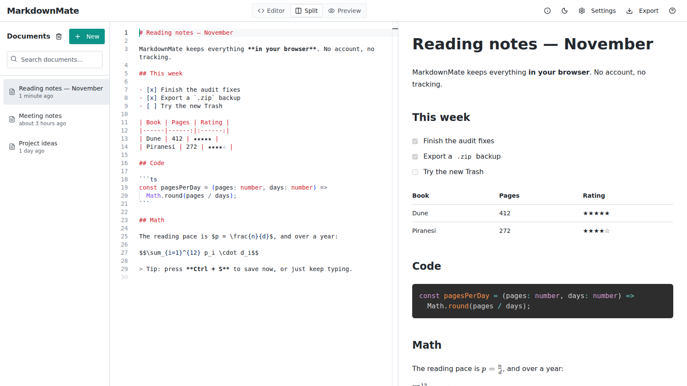

# MarkdownMate

**A fast, local-first Markdown editor with live preview. Your documents stay in your browser.**

<div align="center">
  
  
  
  
  
  <a href="https://github.com/hexawulf/MarkdownMate/actions"></a>
  <a href="LICENSE"></a>
</div>

<p align="center"><strong>Live:</strong> <a href="https://markdownmate.org">markdownmate.org</a></p>



---

## Contents

- [Overview](#overview)
- [Features](#features)
- [Your data](#your-data)
- [Keyboard shortcuts](#keyboard-shortcuts)
- [Quick start](#quick-start)
- [Scripts](#scripts)
- [Project layout](#project-layout)
- [Deployment](#deployment)
- [Privacy and security](#privacy-and-security)
- [Tech stack](#tech-stack)
- [Version history](#version-history)
- [Contributing](#contributing)
- [License](#license)

---

## Overview

MarkdownMate is a single-user Markdown editor for notes and writing. It runs in the browser and stores every document in the browser's IndexedDB. There are no accounts, no cloud sync and no tracking. The small Express server only delivers the app.

You write in Monaco, the editor from VS Code. The preview renders GitHub Flavored Markdown, KaTeX math and highlighted code as you type.

## Features

**Writing**

- Monaco editor with Markdown highlighting, adjustable font size (10–24 px) and word wrap.
- Three views: **Editor**, **Split** (50/50) and **Preview**. The editor keeps its undo history when you switch views.
- GitHub Flavored Markdown: tables, task lists, strikethrough, fenced code blocks.
- Math with KaTeX: inline `$...$` and block `$$...$$`.
- Syntax highlighting in code blocks (Prism).
- Remote images over `https://` show in the preview.
- Status bar with word and character count, cursor position (Ln, Col) and save state.
- Light and dark theme.

**Documents**

- Create, rename, duplicate and search documents. The last edited document moves to the top of the list.
- **Autosave** 500 ms after you stop typing, or save at once with `Ctrl/Cmd + S`.
- **Trash:** deleted documents go to the trash. Restore them, delete them forever or empty the trash. Items older than 30 days are removed automatically.
- **Two tabs, one document:** tabs stay in sync. If the other tab saved a change while you have unsaved edits, a banner asks you to **Reload** or **Keep mine**, so no edit is lost silently.

**Export and backup**

- Export the open document as Markdown (`.md`), as a self-contained HTML file (CSS, math and highlighting inlined), or print it to PDF with a print stylesheet.
- **Export all:** download every document as one `.zip` file (Markdown files plus a `manifest.json`).
- **Import** a `.md` file or a `.zip` backup, in any browser.

## Your data

- Documents live in this browser's IndexedDB (database `markdownmate-db`). They are not sent to the server.
- The app asks the browser for **persistent storage**. The About dialog shows if the browser granted it. If it did not, the browser may clear the data when disk space runs low.
- Clearing site data, using a private window or changing browsers means a different (or empty) document list. Use **Export all** regularly to keep a backup.
- Version 3.2.0 upgrades the database from schema version 1 to version 2 and keeps every document. After the upgrade, older app versions cannot open the database again.
- If MarkdownMate is open in another tab or window while a new version upgrades the database, the new tab asks you to close the other one. It continues by itself as soon as you do. No document is lost.

## Keyboard shortcuts

| Shortcut       | Action                  |
| -------------- | ----------------------- |
| `Ctrl/Cmd + S` | Save the document now   |
| `Ctrl/Cmd + E` | Export as Markdown      |
| `Ctrl/Cmd + /` | Show the shortcuts help |

Inside the editor, the usual Monaco shortcuts work too, for example `Ctrl/Cmd + Z` (undo) and `Ctrl/Cmd + F` (find).

## Quick start

You need **Node.js 22 or later** and npm.

```bash
git clone https://github.com/hexawulf/MarkdownMate.git
cd MarkdownMate
npm ci
npm run dev          # http://localhost:5004 with Vite hot reload
```

Production build:

```bash
npm run build        # client → dist/public, server → dist/index.js
npm start            # NODE_ENV=production node dist/index.js
```

Configuration is small. Copy `.env.example` to `.env` if you want to change it (the server loads `.env` with dotenv):

| Variable   | Default                          | Purpose                     |
| ---------- | -------------------------------- | --------------------------- |
| `PORT`     | `5004`                           | Port to listen on           |
| `NODE_ENV` | (none)                           | `production` serves `dist/` |
| `LOG_FILE` | `/home/zk/logs/markdownmate.log` | Winston log file            |

## Scripts

| Script                  | What it does                                              |
| ----------------------- | --------------------------------------------------------- |
| `npm run dev`           | Express + Vite dev server with hot reload                 |
| `npm run build`         | Clean `dist/`, build the client, bundle the server        |
| `npm start`             | Run the production build                                  |
| `npm test`              | Run the Vitest suite once                                 |
| `npm run test:watch`    | Run Vitest in watch mode                                  |
| `npm run test:coverage` | Run the tests with V8 coverage                            |
| `npm run lint`          | ESLint                                                    |
| `npm run lint:fix`      | ESLint with automatic fixes                               |
| `npm run typecheck`     | TypeScript check (`tsc --noEmit`)                         |
| `npm run metrics:all`   | Measure bundle, Monaco, preview and IndexedDB performance |

CI (GitHub Actions, Node 22) runs type check, lint, tests and build on pushes to `main` and on pull requests.

## Project layout

```text
client/src/
  pages/Editor.tsx       Main screen: views, menus, tab-sync banner
  modules/editor/        Monaco pane, preview, status bar
  modules/about/         About dialog
  components/            Documents sidebar (incl. trash), shared UI
  stores/                Zustand store + IndexedDB (schema, migration, broadcast)
  lib/                   Markdown pipeline, autosave, export, zip backup
  monaco-workers.ts      Local Monaco workers (no CDN)
server/
  app.ts                 Express app, Helmet CSP
  static.ts              Static files and cache headers
  index.ts               Entry point
docs/                    Screenshots and archived design notes
scripts/                 Build helpers and performance measurements
```

## Deployment

MarkdownMate runs on piapps under pm2, behind nginx with TLS.

```bash
git pull --ff-only origin main
npm ci
npm run build
pm2 restart markdownmate      # first time: pm2 start ecosystem.config.cjs && pm2 save
```

`ecosystem.config.cjs` runs `dist/index.js` directly on port 5004 in production mode. A health check is at `/api/health`.

Example nginx server block:

```nginx
server {
    listen 443 ssl http2;
    server_name markdown.example.com;

    ssl_certificate     /etc/letsencrypt/live/markdown.example.com/fullchain.pem;
    ssl_certificate_key /etc/letsencrypt/live/markdown.example.com/privkey.pem;

    location / {
        proxy_pass http://127.0.0.1:5004;
        proxy_http_version 1.1;
        proxy_set_header Host $host;
        proxy_set_header X-Real-IP $remote_addr;
        proxy_set_header X-Forwarded-For $proxy_add_x_forwarded_for;
        proxy_set_header X-Forwarded-Proto $scheme;
    }
}
```

The app already sends its own cache headers (long-lived for hashed assets, `no-cache` for `index.html`) and its own security headers. Do not add a second `X-Frame-Options` or CSP in nginx.

Get a certificate with `sudo certbot --nginx -d markdown.example.com`.

## Privacy and security

- **No accounts, cookies, analytics or tracking.** Documents never leave the browser.
- **Sanitised preview:** `rehype-sanitize` removes unsafe HTML before rendering.
- **Strict Content Security Policy** (Helmet): scripts only from the app itself, no `eval`, no outside connections, Monaco workers from the app itself.
- **Images:** the CSP allows images from `https://` hosts, so remote images in your Markdown load from those hosts. Plain `http://` images are blocked. Images in `data:` URLs also work.
- **No CDN:** all code, fonts and Monaco workers are bundled with the app.
- The server bundle and source maps are not served to the public.

## Tech stack

- **Frontend:** React 18, TypeScript 5, Vite 7, Tailwind CSS 3, Radix UI (shadcn/ui style), Lucide icons, Wouter
- **Editor:** Monaco Editor (ESM build, local workers)
- **State and storage:** Zustand, IndexedDB via `idb`, `BroadcastChannel` for tab sync
- **Markdown:** unified, remark-parse, remark-gfm, remark-math, remark-rehype, rehype-katex, rehype-prism-plus, rehype-sanitize, rehype-stringify
- **Export:** JSZip (loaded only when needed), FileSaver
- **Server:** Express 4, Helmet, Winston, dotenv
- **Tooling:** Vitest, Testing Library, fake-indexeddb, ESLint 9, esbuild

## Version history

See [CHANGELOG.md](CHANGELOG.md) for the full history.

| Version   | Date       | Highlights                                                                                                                 |
| --------- | ---------- | -------------------------------------------------------------------------------------------------------------------------- |
| **3.2.1** | 2026-11-18 | Fix: no endless "Loading…" when an older MarkdownMate tab is still open during the upgrade                                 |
| **3.2.0** | 2026-11-18 | Trash, Export all / Import, persistent storage, tab sync, undo across views, remote https images, DB schema v2             |
| **3.1.0** | 2026-11-12 | Math and code highlighting fixed, per-document autosave, 375 kB entry bundle, server bundle no longer public, tests and CI |
| **3.0.0** | 2026-03-15 | GitHub-style theme, startup race fix, smaller Monaco bundle, hardening                                                     |
| **2.0.0** | 2025-11-02 | Local-first rewrite: IndexedDB, Monaco, split view, autosave, export                                                       |
| **1.0.0** | 2024-12-06 | First release: collaborative editing with Firebase                                                                         |

## Contributing

Contributions are welcome. See [CONTRIBUTING.md](CONTRIBUTING.md) for setup and conventions. Before you open a pull request, run:

```bash
npm run typecheck && npm run lint && npm test && npm run build
```

## License

[MIT](LICENSE) © 0xWulf

<div align="center">
  <p>
    <a href="https://github.com/hexawulf/MarkdownMate/issues/new">Report a bug</a> ·
    <a href="https://github.com/hexawulf/MarkdownMate/issues/new">Request a feature</a>
  </p>
</div>
